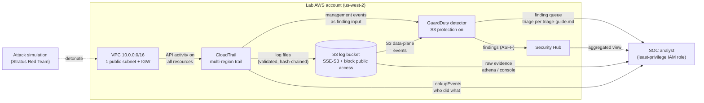

# Architecture — 01-mini-soc

## Data-flow diagram

## What each data flow carries

1. **VPC → CloudTrail.** Every AWS API call made against resources in the
   account (in *any* region, because the trail is multi-region) is recorded as
   a management event: who called it (`userIdentity`), what was called
   (`eventName`), from where (`sourceIPAddress`), and whether it succeeded
   (`errorCode`). This is the raw material for everything downstream.
2. **CloudTrail → S3.** Log files are delivered to the dedicated bucket every
   few minutes. With log file validation enabled, each file carries a digest,
   so tampering with a delivered log is detectable — the "can we trust the
   logs" control.
3. **CloudTrail → GuardDuty.** GuardDuty consumes the management-event stream
   as one of its finding inputs (alongside VPC Flow Logs and DNS logs when
   those exist).
4. **S3 → GuardDuty.** With S3 protection enabled, GuardDuty also monitors
   S3 data-plane activity (object-level access patterns) — this is what makes
   the S3 backdoor scenario (attack-runbook.md, scenario 1) detectable as
   `Policy:S3/BucketAnonymousAccessGranted`.
5. **GuardDuty → Security Hub.** Findings are forwarded in ASFF (AWS Security
   Finding Format), the standard schema. Security Hub is the aggregation
   point: one queue, one format, even after more sources (Inspector, Macie,
   Config) are added later.
6. **Everything → Analyst.** The analyst works from the least-privilege
   `soc-analyst` IAM role: findings from GuardDuty/Security Hub, raw evidence
   from the S3 bucket and CloudTrail LookupEvents. Triage procedure lives in
   `triage-guide.md`.

## Key design decisions

### Why a multi-region trail
Attackers do not confine themselves to `us-west-2`. A single-region trail
records only that region's events; a multi-region trail records management
events from every region into one bucket. The cost difference for a quiet
lab is zero (the first trail's management events are free), while the
coverage difference is total. In an interview: "single-region trail is a
coverage gap I chose not to have."

### Why the S3 log bucket is encrypted and locked down
- **Server-side encryption (SSE-S3):** CloudTrail logs can contain sensitive
  API parameters (user names, ARNs, request details). Encrypting at rest is
  the baseline expectation for any log store, and SSE-S3 adds no key
  management and no KMS cost.
- **Block all public access:** a log bucket must never be publicly readable —
  it is literally a record of everything happening in the account. The public
  access block is the guardrail against the exact misconfiguration class
  (public S3 exposure) that scenario 1 of the attack runbook simulates.
- **Dedicated bucket:** logs live apart from any application data, so a
  bucket-policy mistake on an app bucket cannot take the evidence store down
  with it, and lifecycle/retention policy on logs is independent.

### Why GuardDuty *and* Security Hub (not just one)
They answer different questions. GuardDuty is the **sensor**: it detects.
Security Hub is the **aggregator**: it normalizes and centralizes. A SOC
analyst triages in the aggregator but investigates with the sensor's detail
plus raw logs. Running both mirrors how real SOCs are wired and gives two
different console screenshots for the portfolio.

### Why no NAT gateway, no EC2, no VPC Flow Logs (yet)
Cost discipline is a design decision too. A NAT gateway is ~$32/month; this
lab runs zero instances, so it would be pure waste. VPC Flow Logs are a
deliberate stretch goal: enabling them means CloudWatch Logs ingestion
charges, which breaks the $5–15/month budget on a quiet account. The
architecture supports adding them later (the VPC and subnet already exist) —
that upgrade is itself a second portfolio story: "extended the mini-SOC with
network telemetry."

### Why finding publishing is 15 minutes
GuardDuty's default batches findings every 6 hours — fine for production,
miserable for a lab where you detonate an attack and want to see the finding
before lunch. Fifteen minutes is the fastest setting; it does not change the
price.
